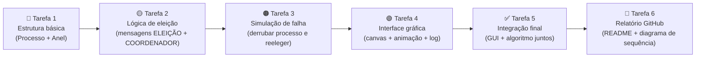
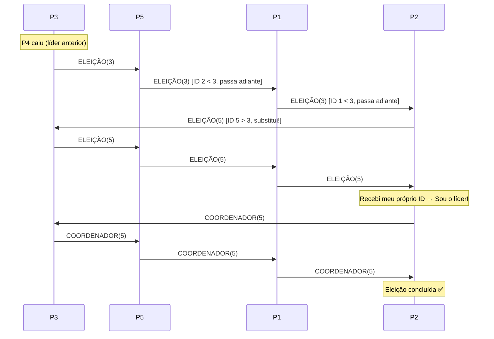

# 🗳️ Plano de Ação — Algoritmo de Eleição em Anel (Grupo 8)

> **Disciplina:** Sistemas Distribuídos — UFSC Araranguá  
> **Tema:** Algoritmo de Eleição – Algoritmo de Anel  
> **Etapa:** 1 — Plano (aguarda aprovação antes do código)

---

## 1. O que é Eleição de Líder e por que o Anel existe?

### Em linguagem simples

Imagine que você está em um **grupo de WhatsApp** sem administrador. O grupo precisa de alguém para moderar as mensagens. Como escolher? Uma solução é todo mundo passar uma mensagem em fila circular — cada pessoa acrescenta seu nome e passa adiante. Quando a mensagem chega de volta em quem começou, todo mundo sabe quem é o candidato com o maior número (ou o mais "importante") e ele vira o administrador.

Em sistemas distribuídos acontece a mesma coisa: vários computadores (processos) precisam **eleger um coordenador** — um processo responsável por tomar decisões centrais, como controlar acesso a um recurso compartilhado. Se esse coordenador cair, o sistema precisa eleger um novo automaticamente.

O **Algoritmo de Anel** resolve isso de forma elegante: os processos são organizados em um anel lógico e as mensagens de eleição circulam por esse anel até que todos concordem com quem é o líder.

### A analogia da fila circular

> 🏫 **Analogia — Eleger o representante da sala:**
>
> Cinco alunos estão sentados em círculo. Ninguém sabe quem tem a maior matrícula (o número mais alto ganha). O aluno A escreve sua matrícula num papel e passa para B. B compara: se a matrícula de B for maior, B risca a de A e escreve a sua. Senão, B passa o papel sem mudar nada. Quando o papel volta para A, o número escrito é o maior de todos — esse aluno é eleito representante. A anuncia: "O representante é o X!" e a mensagem de confirmação circula pelo grupo.

Esse é exatamente o mecanismo do Algoritmo de Anel.

---

## 2. Funcionamento Passo a Passo

### Configuração inicial

Cinco processos formados em anel:

```
  P1 → P2 → P3 → P4 → P5
  ↑________________________↓
```

Cada processo tem um **ID único** (ex.: P1=1, P2=5, P3=3, P4=4, P5=2).  
O anel é **unidirecional**: cada processo só envia para o próximo e só recebe do anterior.

---

### Fase 1 — Detecção de falha e início da eleição

**Situação:** P3 (ID=3) percebe que P4 (antigo líder, ID=4) não responde mais.

| Passo | O que acontece |
|-------|---------------|
| 1 | P3 detecta a falha de P4 (timeout / sem resposta) |
| 2 | P3 dispara uma mensagem `ELEIÇÃO(3)` — "Ei, estou me candidatando com ID 3!" |
| 3 | P3 envia `ELEIÇÃO(3)` para seu vizinho no anel: **P5** (pula P4, que caiu) |

---

### Fase 2 — Circulação da mensagem de eleição

```
P3 → ELEIÇÃO(3) → P5
```

| Quem recebe | ID próprio | Compara | Resultado |
|-------------|-----------|---------|-----------|
| P5 (ID=2)   | 2 < 3     | 3 é maior | Passa `ELEIÇÃO(3)` para P1 |
| P1 (ID=1)   | 1 < 3     | 3 é maior | Passa `ELEIÇÃO(3)` para P2 |
| P2 (ID=5)   | **5 > 3** | 5 é maior! | Substitui: passa `ELEIÇÃO(5)` para P3 |
| P3 (ID=3)   | 3 < 5     | 5 é maior | Passa `ELEIÇÃO(5)` para P5 |
| P5 (ID=2)   | 2 < 5     | 5 é maior | Passa `ELEIÇÃO(5)` para P1 |
| P1 (ID=1)   | 1 < 5     | 5 é maior | Passa `ELEIÇÃO(5)` para P2 |
| P2 (ID=5)   | **5 == 5**| Meu próprio ID voltou! | Sou o **vencedor!** |

---

### Fase 3 — Anúncio do líder

| Passo | O que acontece |
|-------|---------------|
| 1 | P2 envia `COORDENADOR(5)` — "P2 (ID=5) é o novo líder!" |
| 2 | A mensagem circula pelo anel: P3 → P5 → P1 → P2 |
| 3 | Cada processo recebe, registra "líder = P2" e repassa |
| 4 | Quando `COORDENADOR(5)` chega de volta em P2, a eleição termina |

---

### Resumo visual do anel após a eleição

```
  P1 → P2(líder!) → P3 → P5 → P1
             ↑
       [P4 caiu e foi removido do anel]
```

---

## 3. Interface Gráfica Proposta

### Visão geral

A interface terá **uma única janela** dividida em três áreas:

```
┌─────────────────────────────────────────────────────────┐
│  CABEÇALHO: título + status da eleição (texto colorido) │
├──────────────────────────┬──────────────────────────────┤
│                          │                              │
│   ÁREA DO ANEL (canvas)  │   PAINEL DE CONTROLE        │
│                          │                              │
│  Círculos = processos    │  [Iniciar Eleição]           │
│  Setas    = mensagens    │  [Derrubar Processo]        │
│  Cor verde = líder       │  [Reiniciar]                │
│  Cor vermelha = caído    │                              │
│  Animação de mensagem    │  Número de processos: [5]   │
│  percorrendo o anel      │  Velocidade: [slider]       │
│                          │                              │
├──────────────────────────┴──────────────────────────────┤
│  LOG DE MENSAGENS (rolável, estilo terminal)            │
│  > P3 iniciou ELEIÇÃO(3)                               │
│  > P5 recebeu ELEIÇÃO(3), passou ELEIÇÃO(3)            │
│  > P2 recebeu ELEIÇÃO(3), enviou ELEIÇÃO(5) (ID maior) │
│  > P2 recebeu ELEIÇÃO(5) de volta → VENCEDOR!         │
│  > P2 enviou COORDENADOR(5)                            │
└─────────────────────────────────────────────────────────┘
```

### O que o usuário vê e clica

| Elemento | Descrição |
|----------|-----------|
| **Canvas do anel** | Processos aparecem como círculos numerados dispostos em anel. Uma bolinha colorida anima-se ao longo das setas, representando cada mensagem em trânsito. |
| **Cores dos nós** | 🟡 Normal · 🟢 Líder eleito · 🔴 Processo caído · 🔵 Recebendo/enviando mensagem |
| **Botão "Iniciar Eleição"** | Dispara a eleição a partir de um processo aleatório (ou clicando num nó específico) |
| **Botão "Derrubar Processo"** | O usuário clica num nó do anel para "matar" aquele processo e observar o anel se reorganizar |
| **Botão "Reiniciar"** | Reseta a simulação para o estado inicial |
| **Slider de velocidade** | Controla a velocidade da animação (devagar para ver cada passo, rápido para ver o resultado) |
| **Log de mensagens** | Painel de texto mostrando cada mensagem trocada em tempo real, com timestamp |

### Fluxo de uso

1. Usuário vê o anel com 5 processos; nenhum é líder ainda.
2. Usuário clica "Iniciar Eleição" (ou clica num nó específico para ele iniciar).
3. Uma bolinha azul percorre o anel; o log mostra cada `ELEIÇÃO(x)`.
4. Quando o maior ID vence, o nó correspondente fica verde e o log exibe `COORDENADOR(x)`.
5. Usuário pode clicar "Derrubar Processo" no líder atual → uma nova eleição começa automaticamente.
6. Usuário pode clicar "Reiniciar" para começar tudo de novo.

---

## 4. Partes do Programa e seus Papéis

| Componente | O que faz | Analogia |
|------------|-----------|----------|
| **Processo (nó)** | Representa um computador no anel. Tem um ID único, sabe quem é seu vizinho e processa as mensagens recebidas. | Um aluno na fila circular |
| **Anel** | Estrutura que conecta os processos em ordem circular e gerencia o envio de mensagens de um para o próximo. | A fila circular de alunos |
| **Mensagem** | Pacote de dados trocado entre processos: pode ser `ELEIÇÃO(id)` ou `COORDENADOR(id)`. | O papel que circula na fila |
| **Motor de Eleição** | Lógica central do algoritmo: decide quando iniciar eleição, como comparar IDs e quando declarar o vencedor. | As regras do jogo de eleição |
| **Interface (GUI)** | Exibe os processos visualmente, anima as mensagens, permite ao usuário interagir. | O quadro-negro onde a professora mostra o exemplo |
| **Log** | Registra cada evento em texto, para o usuário acompanhar o que está acontecendo nos bastidores. | O caderno de atas da sala |

---

## 5. Linguagem Recomendada: **Python + Tkinter**

### Por quê Python?

| Critério | Python + Tkinter |
|----------|-----------------|
| **Curva de aprendizado** | Muito baixa — código legível, sem compilação |
| **GUI incluída** | `tkinter` vem na instalação padrão do Python, sem dependências extras |
| **Código didático** | Lógica do algoritmo cabe em ~150 linhas claras |
| **Execução** | Um único arquivo `.py`, roda com `python anel.py` |
| **Visualização** | `tkinter Canvas` permite desenhar círculos e setas com 10 linhas de código |

> **Por que não C/C++?** A gestão de memória e a criação de GUI desviariam o foco do algoritmo.  
> **Por que não JavaScript?** Exigiria Node.js ou um navegador, e o código de rede ficaria mais complexo.

Python com Tkinter mantém **tudo em um arquivo**, sem frameworks, sem servidores — só o algoritmo e a tela.

---

## 6. Cronograma de Tarefas (do mais simples ao mais completo)



| # | Tarefa | O que está pronto ao final |
|---|--------|---------------------------|
| 1 | Estrutura base | Classes `Processo` e `Anel` funcionando no terminal |
| 2 | Lógica de eleição | Eleição completa rodando via `print()` no console |
| 3 | Falha de processo | Teste com processo caído, nova eleição automática |
| 4 | Interface gráfica | Anel visual com nós e setas no canvas |
| 5 | Integração | Algoritmo + GUI totalmente integrados com animação |
| 6 | Relatório | README no GitHub com instruções e diagrama de sequência |

---

## 7. Diagrama de Sequência (para o Relatório)



---

> [!IMPORTANT]
> **Esta é a Etapa 1 — apenas o plano, sem nenhum código.**  
> Posso seguir para a **Etapa 2 (implementação)** assim que você aprovar este plano.  
>
> **Deseja seguir para a Etapa 2?**  
> Se quiser ajustar algo (número de processos, estilo da interface, linguagem, etc.) me diga antes de aprovar!